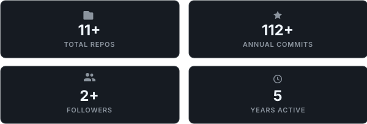
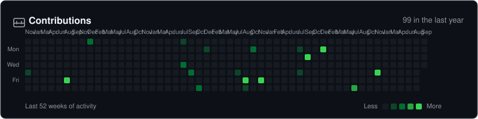

<!-- Welcome Banner Card (Responsive Desktop/Tablet/Mobile & Light/Dark Theme) -->

  <picture>
    <source media="(max-width: 768px) and (prefers-color-scheme: dark)" srcset="assets/welcome-banner-mobile-dark.svg">
    <source media="(max-width: 768px) and (prefers-color-scheme: light)" srcset="assets/welcome-banner-mobile-light.svg">
    <source media="(min-width: 769px) and (prefers-color-scheme: dark)" srcset="assets/welcome-banner-dark.svg">
    <source media="(min-width: 769px) and (prefers-color-scheme: light)" srcset="assets/welcome-banner-light.svg">
    
  </picture>

<!-- 4 Quick Stats Cards (Adaptive 4-col on Desktop, 2x2 Grid on Mobile/Tablet) -->

  <picture>
    <source media="(max-width: 768px) and (prefers-color-scheme: dark)" srcset="assets/quick-stats-mobile-dark.svg">
    <source media="(max-width: 768px) and (prefers-color-scheme: light)" srcset="assets/quick-stats-mobile-light.svg">
    <source media="(min-width: 769px) and (prefers-color-scheme: dark)" srcset="assets/quick-stats-dark.svg">
    <source media="(min-width: 769px) and (prefers-color-scheme: light)" srcset="assets/quick-stats-light.svg">
    
  </picture>

<!-- Contributions Activity Heatmap (Scalable Vector & Light/Dark Theme) -->

  <a href="https://github.com/ramadhan-imanur">
    <picture>
      <source media="(prefers-color-scheme: dark)" srcset="assets/contributions-dark.svg">
      <source media="(prefers-color-scheme: light)" srcset="assets/contributions-light.svg">
      
    </picture>
  </a>

<!-- Tech Stack & Languages Section (Responsive Auto-Wrapping on Mobile/Tablet) -->
### Tech Stack & Languages

  <picture>
    <source media="(prefers-color-scheme: dark)" srcset="assets/core-tech-dark.svg">
    <source media="(prefers-color-scheme: light)" srcset="assets/core-tech-light.svg">
    
  </picture>
  &nbsp;
  <picture>
    <source media="(prefers-color-scheme: dark)" srcset="assets/languages-donut-dark.svg">
    <source media="(prefers-color-scheme: light)" srcset="assets/languages-donut-light.svg">
    
  </picture>

---

### About Me

Undergraduate Mathematics student focused on applied computation, mathematical modeling, and data science. Strong foundation in pure and applied mathematics, using Python for data science & statistical modeling, Wolfram Mathematica for symbolic and numerical computation, and SQL for relational database architecture.

  
  

