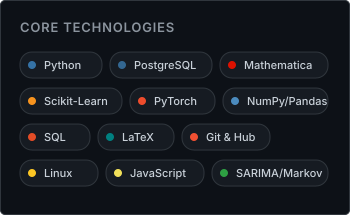

<!-- Welcome Banner Card -->

  

<!-- 4 Quick Stats Cards Grid -->

  

<!-- Contributions Activity Heatmap -->

  

<!-- Tech Stack & Languages Section -->
### Tech Stack & Languages

  
  

---

### About Me

Undergraduate Mathematics student focused on applied computation, mathematical modeling, and data science. Strong foundation in pure and applied mathematics, using Python for data science & statistical modeling, Wolfram Mathematica for symbolic and numerical computation, and SQL for relational database architecture.

  
  

