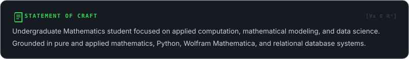
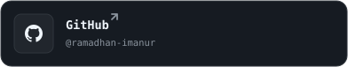
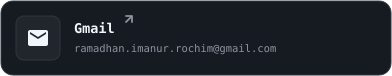
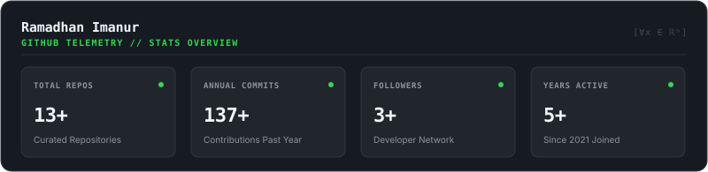

<!-- Welcome Cosmic Math Hero Banner (Adaptive Light/Dark Theme & Mobile Responsive) -->

  <picture>
    <source media="(prefers-color-scheme: dark)" srcset="assets/welcome-banner-dark.svg">
    <source media="(prefers-color-scheme: light)" srcset="assets/welcome-banner-light.svg">
    
  </picture>

<!-- Programming Languages Donut Visualizer Card (Adaptive Light/Dark Theme) -->

  <picture>
    <source media="(prefers-color-scheme: dark)" srcset="assets/donut-card-dark.svg">
    <source media="(prefers-color-scheme: light)" srcset="assets/donut-card-light.svg">
    
  </picture>

<!-- Statement of Craft (Adaptive Light/Dark Theme) -->

  <picture>
    <source media="(prefers-color-scheme: dark)" srcset="assets/statement-craft-dark.svg">
    <source media="(prefers-color-scheme: light)" srcset="assets/statement-craft-light.svg">
    
  </picture>

<!-- Channels // Connect Section Header -->

  <picture>
    <source media="(prefers-color-scheme: dark)" srcset="assets/connect-header-dark.svg">
    <source media="(prefers-color-scheme: light)" srcset="assets/connect-header-light.svg">
    
  </picture>

<!-- Interactive Connect Endpoint Cards (Native Clickable Links) -->

  <a href="https://github.com/ramadhan-imanur" target="_blank" rel="noopener noreferrer">
    <picture>
      <source media="(prefers-color-scheme: dark)" srcset="assets/connect-github-dark.svg">
      <source media="(prefers-color-scheme: light)" srcset="assets/connect-github-light.svg">
      
    </picture>
  </a>
  <a href="mailto:ramadhan.imanur.rochim@gmail.com">
    <picture>
      <source media="(prefers-color-scheme: dark)" srcset="assets/connect-email-dark.svg">
      <source media="(prefers-color-scheme: light)" srcset="assets/connect-email-light.svg">
      
    </picture>
  </a>

<!-- GitHub Telemetry Stats Overview Card (Adaptive Light/Dark Theme) -->

  <picture>
    <source media="(prefers-color-scheme: dark)" srcset="assets/stats-card-dark.svg">
    <source media="(prefers-color-scheme: light)" srcset="assets/stats-card-light.svg">
    
  </picture>

