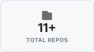
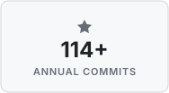
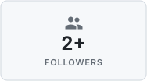
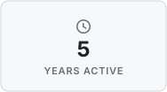
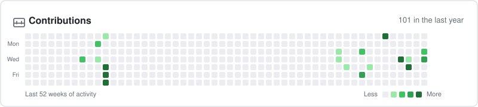
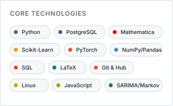

<!-- Welcome Banner Card (Adaptive Light/Dark Theme & Mobile Responsive) -->

  <picture>
    <source media="(prefers-color-scheme: dark)" srcset="assets/welcome-banner-dark.svg">
    <source media="(prefers-color-scheme: light)" srcset="assets/welcome-banner-light.svg">
    
  </picture>

<!-- 4 Quick Stats Cards (Adaptive 4-in-a-row on Desktop, 2x2 on Mobile/Tablet) -->

  <picture>
    <source media="(prefers-color-scheme: dark)" srcset="assets/stat-repos-dark.svg">
    <source media="(prefers-color-scheme: light)" srcset="assets/stat-repos-light.svg">
    
  </picture>
  <picture>
    <source media="(prefers-color-scheme: dark)" srcset="assets/stat-commits-dark.svg">
    <source media="(prefers-color-scheme: light)" srcset="assets/stat-commits-light.svg">
    
  </picture>
  <picture>
    <source media="(prefers-color-scheme: dark)" srcset="assets/stat-followers-dark.svg">
    <source media="(prefers-color-scheme: light)" srcset="assets/stat-followers-light.svg">
    
  </picture>
  <picture>
    <source media="(prefers-color-scheme: dark)" srcset="assets/stat-years-dark.svg">
    <source media="(prefers-color-scheme: light)" srcset="assets/stat-years-light.svg">
    
  </picture>

<!-- Contributions Activity Heatmap -->

  <a href="https://github.com/ramadhan-imanur">
    <picture>
      <source media="(prefers-color-scheme: dark)" srcset="assets/contributions-dark.svg">
      <source media="(prefers-color-scheme: light)" srcset="assets/contributions-light.svg">
      
    </picture>
  </a>

<!-- Tech Stack & Languages Section (Auto-Wrapping Responsively) -->
### Tech Stack & Languages

  <picture>
    <source media="(prefers-color-scheme: dark)" srcset="assets/core-tech-dark.svg">
    <source media="(prefers-color-scheme: light)" srcset="assets/core-tech-light.svg">
    
  </picture>
  <picture>
    <source media="(prefers-color-scheme: dark)" srcset="assets/languages-donut-dark.svg">
    <source media="(prefers-color-scheme: light)" srcset="assets/languages-donut-light.svg">
    
  </picture>

---

### About Me

Undergraduate Mathematics student focused on applied computation, mathematical modeling, and data science. Strong foundation in pure and applied mathematics, using Python for data science & statistical modeling, Wolfram Mathematica for symbolic and numerical computation, and SQL for relational database architecture.

  
  

